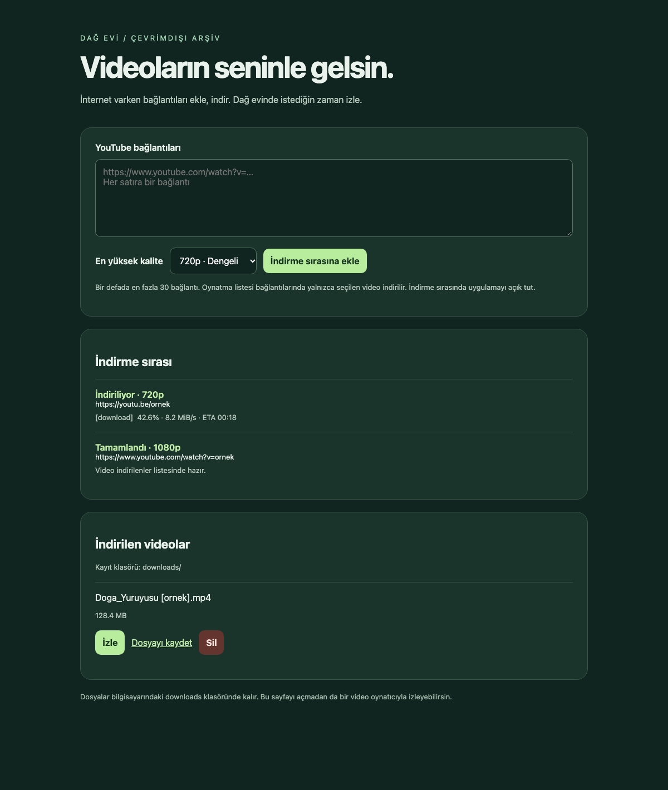

<p align="center">
  
</p>

<p align="center">
  <a href="https://www.python.org/"></a>
  <a href="https://github.com/yt-dlp/yt-dlp"></a>
  
  
</p>

# Dağ Evi · YouTube Video Arşivi

İnternet varken videolarını hazırla; dağ evinde, yolculukta veya bağlantı olmayan bir yerde izlemeye devam et. **Dağ Evi**, bilgisayarında çalışan Türkçe bir YouTube indirme uygulamasıdır. Bağlantıları sıraya alır, seçtiğin kalite sınırında sesli MP4 dosyaları oluşturur ve kişisel arşivini tek ekranda toplar.

<p align="center">
  <a href="#kurulum">Kurulum</a> · <a href="#kullanım">Kullanım</a> · <a href="#nasıl-çalışır">Nasıl çalışır?</a> · <a href="#sorun-giderme">Sorun giderme</a>
</p>

## Arayüze göz at



*Gerçek uygulama arayüzü; indirme durumları ve dosya bilgileri gösterim amacıyla örnek verilerle doldurulmuştur.*

## Neler yapabilirsin?

| Özellik | Açıklama |
| --- | --- |
| Toplu bağlantı ekleme | Her satıra bir bağlantı; tek seferde en fazla 30 video. |
| Kalite seçimi | 360p, 480p, 720p veya 1080p üst sınırı. |
| İndirme takibi | Sıra, indirme, birleştirme ve hata durumları aynı ekranda. |
| Yerel video arşivi | Videoları tarayıcıda izle, dosyayı kaydet veya arşivden sil. |
| Çevrimdışı izleme | MP4 dosyalarını VLC, QuickTime veya uyumlu bir oynatıcıda aç. |
| Yerel çalışma | Sunucu yalnızca `127.0.0.1` üzerinde çalışır; arayüz harici servis veya CDN gerektirmez. |

## Kurulum

**Gereksinimler:** Python 3.10+ ve Deno ya da Node.js 22+. FFmpeg, `imageio-ffmpeg` bağımlılığıyla sağlanır; sistemde kuruluysa öncelikle o kullanılır.

```sh
git clone https://github.com/seyitbugraerden/Phyton-DownloadYoutubeMP4.git
cd Phyton-DownloadYoutubeMP4
```

### macOS / Linux

macOS'ta sistem araçlarını Homebrew ile kurabilirsin:

```sh
brew install python deno
```

Linux'ta Python ve Deno'yu sistemine uygun yöntemle kur. Ardından proje klasöründe:

```sh
python3 -m venv .venv
source .venv/bin/activate
python -m pip install --upgrade pip
python -m pip install -r requirements.txt
python app.py
```

### Windows

Python ve Deno ya da Node.js 22+ kurulumunu tamamla; komutların PATH üzerinden erişilebilir olduğundan emin ol. Komut İstemi'nde:

```bat
py -m venv .venv
.venv\Scripts\activate.bat
python -m pip install --upgrade pip
python -m pip install -r requirements.txt
python app.py
```

Tarayıcı otomatik açılır: **http://127.0.0.1:8765**. macOS'ta sonraki açılışlar için `start.command` dosyasına çift tıklayabilirsin. Uygulamayı durdurmak için terminalde **Ctrl+C** kullan.

## Kullanım

1. İnternet bağlantın varken YouTube bağlantılarını, her satıra bir tane gelecek şekilde yapıştır.
2. İstediğin en yüksek kaliteyi seç ve **İndirme sırasına ekle** düğmesine bas.
3. İlerlemeyi **İndirme sırası** bölümünden takip et; işlem boyunca uygulamayı açık tut.
4. Tamamlanan videoları **İndirilen videolar** bölümünden izle veya `downloads/` klasöründen aç.

> Kalite seçimi bir üst sınırdır. Kaynakta bulunmayan çözünürlük yükseltilmez. Çevrimdışı kullanmadan önce dosyaların sesini ve görüntüsünü kontrol et.

## Nasıl çalışır?


Python'un standart HTTP sunucusu arayüzü sunar; arka plandaki tek işçi videoları sırayla indirir. yt-dlp uygun video ve ses akışlarını seçer, gerektiğinde FFmpeg bunları birleştirir.

```text
.
├── app.py              # Yerel sunucu, indirme sırası ve dosya işlemleri
├── static/index.html   # Türkçe web arayüzü
├── docs/images/        # README görselleri
├── tests/test_app.py   # Sunucu ve dosya işlemleri testleri
├── requirements.txt    # Python bağımlılıkları
├── start.command       # macOS başlatıcısı
└── downloads/          # İndirilen videolar (çalışırken oluşturulur)
```

### Bilmen gerekenler

- Aktif sırada en fazla 100 iş tutulur. Sıra bellektedir; yeniden başlatınca sıfırlanır, indirilen dosyalar kalır.
- İndirme komutunda dosya boyutu üst sınırı 5 GB olarak ayarlanır.
- Oynatma listeleri topluca indirilmez; yalnızca seçilen video işlenir. Canlı yayınlar arşiv için önerilmez.
- Öncelikle H.264 video ve M4A ses seçilir; alternatif olarak uygun birleşik MP4 aranır. Uygun format bulunamazsa hata gösterilir.
- Giriş, yaş kısıtlaması veya bot doğrulaması isteyen videolar indirilemeyebilir. Uygulama oturum çerezi toplamaz.
- Yeni indirmeler internet bağlantısı gerektirir. Yerel sunucuyu internete açma.

## Sorun giderme

| Durum | Yapılabilecek işlem |
| --- | --- |
| Video indirilemiyor | İnternet bağlantısını kontrol et ve aşağıdaki komutla bağımlılıkları güncelle. |
| FFmpeg bulunamadı | `python -m pip install -r requirements.txt` komutunu tekrar çalıştır veya sistemine FFmpeg kur. |
| JavaScript çalışma ortamı hatası | Deno veya Node.js 22+ kurulumunu ve PATH ayarını kontrol et. |
| 8765 portu kullanımda | macOS/Linux'ta `PORT=8766 python app.py`; Windows Komut İstemi'nde önce `set PORT=8766`, sonra `python app.py` çalıştır. |
| İndirme yarıda kaldı | Aynı bağlantıyı yeniden sıraya ekleyerek tekrar dene. |
| Arayüz sunucuya ulaşamıyor | Python sürecinin açık olduğunu ve doğru yerel adresi kullandığını kontrol et. |

Sanal ortam etkin durumdayken güncelle:

```sh
python -m pip install -U -r requirements.txt
```

Testleri çalıştır:

```sh
python -m unittest discover -s tests -v
```

Yalnızca indirme hakkın veya iznin olan içerikleri kullan. İndirme motoru hakkında ayrıntılar için [yt-dlp belgelerine](https://github.com/yt-dlp/yt-dlp#readme) bakabilirsin.
